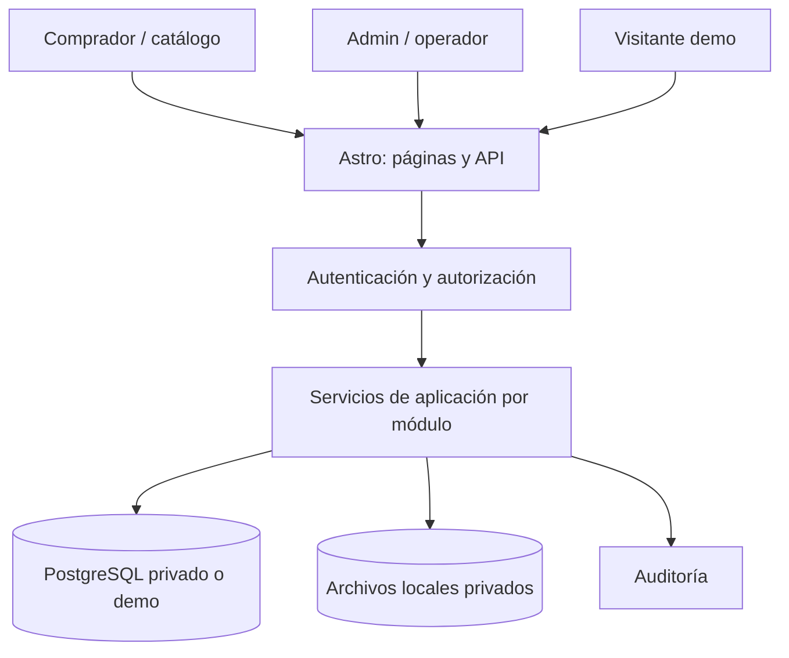
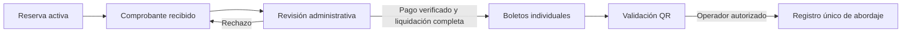

# 03 — Arquitectura

## Estilo
**Monolito modular full-stack** en Astro con componentes React donde exista interacción. Bun ejecuta aplicación y scripts. PostgreSQL con Drizzle mantiene el estado persistente. Archivos privados se guardan en disco local fuera del directorio público.

## Separación de responsabilidades
- **Rutas Astro / endpoints:** parsean entrada, validan sesión, ejecutan política, llaman al caso de uso, construyen respuesta.
- **React islands:** formularios, filtros, editor, escáner y componentes interactivos; no guardan secretos ni implementan autorización real.
- **Servicios de aplicación:** transacciones y coordinación de casos de uso.
- **Dominio:** invariantes, cálculos monetarios, transiciones y políticas.
- **Repositorios Drizzle:** acceso persistente; no toman decisiones de permisos.
- **Infraestructura:** Better Auth, storage local, generación de QR, render de flyers.

## Módulos
`identity`, `catalog`, `bookings`, `payments`, `tickets`, `operations`, `marketing`, `demo`, `audit`.

## Aislamiento de datos
Se recomienda una misma instancia PostgreSQL Docker con **dos bases distintas** (`traveltech_private`, `traveltech_demo`) y migraciones idénticas. Los datos semilla solo se cargan en la base demo. La selección de conexión ocurre en servidor mediante contexto autenticado y rutas permitidas; nunca se acepta un nombre de base enviado por cliente. El acceso administrativo privado no debe mezclarse con sesiones de visitante.

## Flujo: reserva

## Flujo: pago y abordaje

## Convenciones técnicas
- Importes en centavos enteros, sin floats.
- UUID para claves; códigos legibles separados de IDs internos.
- Fechas persistidas con zona/instantes UTC y zona de agencia para calendarios.
- Transacciones con bloqueos/actualizaciones condicionales para capacidad y asignaciones.
- Restricciones únicas en BD para operaciones que no pueden duplicarse.
- Errores tipados; mensajes públicos sin información interna.
- Registro de auditoría en la misma transacción cuando sea necesario.

## Decisiones de integración aplazadas
Correo real, almacenamiento de objetos, colas, cron productivo, IA, pagos en línea y hosting. Definir interfaces de adaptadores para poder incorporarlos sin cambiar reglas del dominio.
