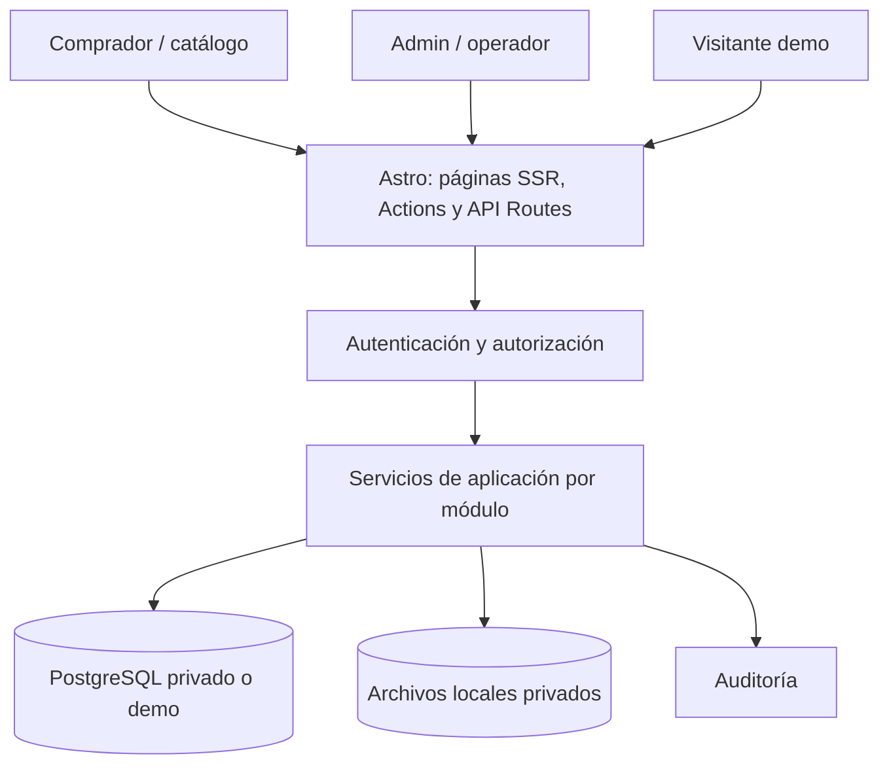
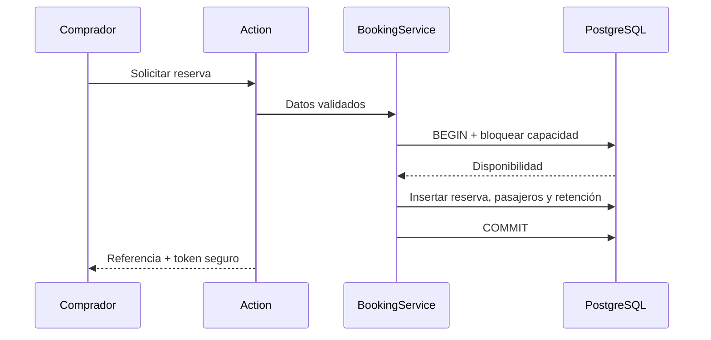
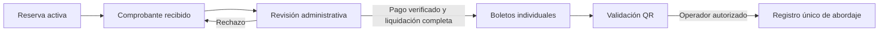

# 03 — Arquitectura

## Estilo
**Monolito modular full-stack** en Astro con componentes React donde exista interacción. Bun ejecuta la aplicación (servidor) y los scripts; las CLI de Astro y `drizzle-kit` requieren además Node.js (ver [ADR-015](../05-decisiones/11-decisions-and-risks.md)). PostgreSQL con Drizzle mantiene el estado persistente. Archivos privados se guardan en disco local fuera del directorio público.



## Separación de responsabilidades
([ADR-025](../05-decisiones/11-decisions-and-risks.md) y [ADR-026](../05-decisiones/11-decisions-and-risks.md))
- **Astro Actions** (`src/actions/`): validan la entrada con Zod, verifican sesión y permiso **en cada handler**, invocan al servicio y devuelven el resultado. No contienen reglas de negocio.
- **Páginas SSR:** renderizan las lecturas (catálogo público, panel) llamando a los servicios en el servidor.
- **API Routes:** solo ante una necesidad HTTP específica (archivos privados, QR para clientes externos, integraciones, Better Auth, salud). No hay una API REST paralela a las Actions.
- **React islands:** formularios, filtros, editor, escáner y componentes interactivos; llaman a Actions; no guardan secretos ni implementan autorización real.
- **Servicios de aplicación:** clases que implementan casos de uso, coordinan dependencias y gestionan las transacciones.
- **Dominio:** invariantes, cálculos monetarios, transiciones y políticas; funciones puras cuando basten.
- **Repositorios:** clases Drizzle para persistencia y consultas; no toman decisiones de permisos.
- **Infraestructura:** Better Auth, PostgreSQL, storage local, generación de QR, render de flyers.
- **Composición:** un `container.ts` por módulo, con factories simples que construyen repositorios y servicios.

## Inyección de dependencias y transacciones
- **Constructor, sin contenedor:** los servicios reciben sus dependencias por constructor. No se usan contenedores de DI, decoradores ni librerías. Se definen interfaces solo para lo que de verdad necesita abstracción (sobre todo repositorios); funciones donde la lógica sea simple y pura.
- **Sin conexión global:** un servicio no importa la base de datos; la conexión se crea en la composición a partir de la base elegida en el servidor.
- **Transacciones en el caso de uso:** una operación atómica es una sola transacción en la que pueden participar varios repositorios sobre el mismo ejecutor (`db` o `tx`); no se abren transacciones independientes dentro de ella. Las restricciones de la base son la última defensa.
- **Estructura de un módulo** (orientativa; se crea cuando recibe su primer archivo):

```text
src/modules/catalog/
  domain/           # reglas puras e interfaces de repositorio
  application/      # servicios (casos de uso)
  infrastructure/   # repositorios Drizzle
  container.ts      # factory de repositorios y servicios
  schema.ts         # tablas Drizzle (compuestas en src/db/schema.ts)
  relations.ts
```

## Módulos
`identity`, `catalog`, `bookings`, `payments`, `tickets`, `operations`, `marketing`, `demo`, `audit`.

## Aislamiento de datos
Se recomienda una misma instancia PostgreSQL Docker con **dos bases distintas** (`traveltech_private`, `traveltech_demo`) y migraciones idénticas. Los datos semilla solo se cargan en la base demo. La selección de conexión ocurre en servidor mediante contexto autenticado y rutas permitidas; nunca se acepta un nombre de base enviado por cliente. El acceso administrativo privado no debe mezclarse con sesiones de visitante.

## Flujo: reserva


## Flujo: pago y abordaje


## Convenciones técnicas
- Importes en centavos enteros, sin floats.
- UUID para claves; códigos legibles separados de IDs internos.
- Fechas persistidas con zona/instantes UTC y zona de agencia para calendarios.
- Transacciones con bloqueos/actualizaciones condicionales para capacidad y asignaciones.
- Restricciones únicas en BD para operaciones que no pueden duplicarse.
- Errores tipados; mensajes públicos sin información interna.
- Registro de auditoría en la misma transacción cuando sea necesario.

## Decisiones de integración aplazadas
Correo real, almacenamiento de objetos, colas, cron productivo, IA, pagos en línea y hosting. Definir interfaces de adaptadores para poder incorporarlos sin cambiar reglas del dominio.
